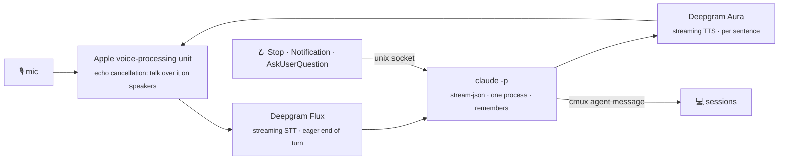

<p align="center">
  
</p>
<p align="center">
  
</p>
<p align="center">
  <b>A voice in front of your Claude Code sessions.</b>
</p>
<p align="center">
  <a href="https://github.com/ActurialCapital/claudio/actions/workflows/test.yml"></a>
  <a href="LICENSE"></a>
  
  
  
  
</p>

<br>

<p align="center">
  
</p>

You talk. It answers in a sentence or two, or hands the work to one of your Claude Code sessions and tells you when that session is done, asks something, or needs a permission.

## 🚀 Install

```bash
uv tool install git+https://github.com/ActurialCapital/claudio
cd ~/code/myproject && claudio
```

First run is a short setup: your [Deepgram](https://console.deepgram.com) key, the cmux workspace that is your orchestrator, a voice, the brain's model and effort. It installs the Claude Code hooks for you.

## ⚙️ How it works


- 💬 **Discussing?** The brain answers itself, reading the project when it needs facts.
- 🛠️ **Work?** It sends the task to your orchestrator through cmux's agent inbox and says so.
- 📣 **Sessions report back** through Claude Code hooks. Claudio narrates in plain words and reads out questions and permission prompts; you answer those on the keyboard.

## 🎙️ Say

| | |
|---|---|
| "what's the sequencer doing?" | reads that pane, sums it up |
| "rebase 44 and run the tests" | hands it to the orchestrator |
| "open a session called Core" | new cmux workspace running `claude` |
| "use Sonnet" · "the orchestrator is Core now" | changes a setting, kept for next time |
| "slash clear" · "slash status" · "slash help" | the slash commands, spoken |
| "slash mute" · "slash unmute" | hears nothing until you unmute |
| talk over it | pauses; a real turn cuts it, an "mm-hm" lets it go on |
| type a line | a turn, for when you can't talk |

<kbd>Enter</kbd> cuts a reply · <kbd>Ctrl</kbd>+<kbd>C</kbd> quits

## 🖥️ On screen

- The state line at the bottom follows what is happening: a mic level, then listening, thinking, speaking, paused, muted, and what the orchestrator is up to (idle, working, waiting on you), glanced from its pane every few seconds.
- Each sentence appears as it is spoken, not before, so the transcript keeps time with the voice.
- Under each lead-in, dim lines of what the brain is reading or running. After each reply, how long it took to the first word.
- A permission prompt is read with the actual command from the session's pane, not just "needs permission".
- When a session reports back, the request it was for is shown above the narration.
- Every conversation is kept in `~/.config/claudio/transcripts/YYYY-MM-DD.md`.

## 🔬 Under the hood



- 🍎 macOS · 🖥️ [cmux](https://cmux.dev) · 🎧 [Deepgram](https://deepgram.com) · 🧠 your Claude plan
- The brain starts on Flux's eager end of turn; its audio is held until the final transcript agrees.
- Ears reconnect, the brain restarts if it dies, the mouth retries. Errors in `~/.config/claudio/brain.log`.

## 🎛️ Settings

`~/.config/claudio/config.json`, written by setup and by voice. `prompt.md` beside it is the persona.

| key | default | |
|---|---|---|
| `orchestrator` | | cmux workspace that gets tasks by default |
| `model` · `effort` | `default` · `low` | the brain, through your Claude Code login |
| `voice` | `aura-2-orion-en` | any Deepgram Aura-2 voice |
| `ears` | `flux-general-en` | `flux-general-multi` for other languages |
| `eager_eot` · `eot` · `eot_timeout_ms` | `0.3` · `0.7` · `1500` | end-of-turn tuning |
| `barge_in` | `true` | talking over it pauses it |
| `push_to_talk` | `false` | the mic stays closed until you press Enter, for one turn |
| `address_me` | `false` | only turns that start with "claudio" count, for a room with other people |
| `memory` | `true` | resume the last conversation, up to a week old |

`claudio doctor` checks everything and runs one typed turn · `claudio forget` resets memory · `claudio set <key> <value>`

<details>
<summary>🖐️ Hands-free picking of multiple-choice answers</summary>
<br>
By default claudio reads a session's multiple-choice question aloud and you press the key. To let your spoken answer press it, add <code>"Bash(cmux send-key:*)"</code> to the brain's allowed tools in <code>claudio/agent.py</code>; the persona already knows the keystrokes. A misheard "yes" can then press keys in your sessions.
</details>

<br>

<p align="center"><sub>MIT · made with Claude Code</sub></p>
