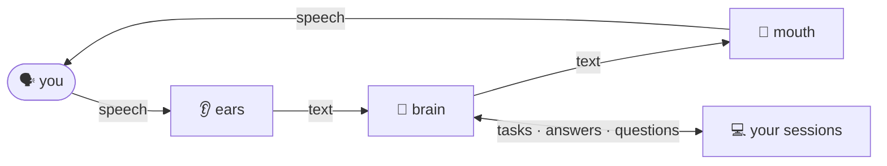
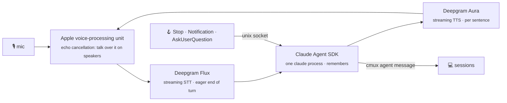

<p align="center">
  
</p>
<p align="center">
  <b>A voice in front of your Claude Code sessions.</b>
</p>
<p align="center">
  <a href="https://claudio-vert.vercel.app/docs"></a>
  <a href="LICENSE"></a>
  
  
  
  
</p>

<br>

<p align="center">
  
</p>

You talk. It answers in a sentence or two, or hands the work to one of your Claude Code sessions and tells you when that session is done, asks something, or needs a permission. It is not a reading bot: a separate small brain talks with you, decides whether you are discussing or asking for work, and narrates what your sessions report back in plain words.

## 🚀 Install

```bash
uv tool install git+https://github.com/ActurialCapital/claudio
cd ~/code/myproject && claudio
```

The first run is a short setup: your [Deepgram](https://console.deepgram.com) key, the cmux workspace that is your orchestrator, a voice, the brain's model and effort. It installs the Claude Code hooks for you. `claudio doctor` checks everything afterwards.

**Full documentation: [claudio-vert.vercel.app/docs](https://claudio-vert.vercel.app/docs)**, from setup to every setting and what to do when something goes wrong.

## ⚙️ How it works



- 💬 **Discussing?** The brain answers itself, reading the project when it needs facts.
- 🛠️ **Work?** It sends the task to your orchestrator through cmux's agent inbox and says so.
- 📣 **Sessions report back** through Claude Code hooks. Claudio narrates in plain words, with the request it was for, and reads out questions and permission prompts with the actual command. You answer those on the keyboard.

## 🎙️ Say

| | |
|---|---|
| "what's the sequencer doing?" | reads that pane, sums it up |
| "rebase 44 and run the tests" | hands it to the orchestrator |
| "open a session called Core" | new cmux workspace running `claude` |
| "use Sonnet" · "the orchestrator is Core now" | changes a setting, kept for next time |
| "slash clear" · "slash status" · "slash help" | the slash commands, spoken |
| "slash style brief" · "caveman" · "plain" | how it talks: one sentence, caveman, or plain |
| "slash mute" · "slash unmute" | hears nothing until you unmute |
| "slash code colors off" | code blocks as plain text; "on" brings colours back |
| "what did we do today?" | reads today's transcript and tells you |
| "write a note: call Michael" | asks Desktop or Documents, then adds it to `notes.md` there, dated |
| "search what Aura-2 costs" | searches the web, says the answer, shows the links |
| "open issue 727 in the browser" | opens it, or a Google search, and says only "Opening it." |
| "yes", "always" or "no", when it asks to allow a command | yes runs it once; always also adds it to `settings.json`; the reply goes on |
| talk over it | pauses; a real turn cuts it, an "mm-hm" lets it go on |
| type a line | a turn, for when you can't talk |

<kbd>Enter</kbd> cuts a reply · <kbd>Ctrl</kbd>+<kbd>C</kbd> quits · typed `/mute`, `/effort low`, `/clear` work too

## 🖥️ On screen

```
› rebase 44 on main and run the tests
◆ Sending that to Sequencer.
  → cmux agent message

▸ Sequencer  done  ·  for "rebase 44 on main and run the tests"
◆ Rebased, tests pass, nothing to fix.

▃ listening  ·  1.1 s to first word  ·  Sequencer idle
```

- `›` you, `◆` claudio, `▸` a session reporting back with the request it was for, `→` what the brain is reading or running, `⚙` a setting you changed, `·` a note, `!` a warning. Room noise and "mm-hm"s show dim.
- 📊 The state line: a spinner, a still `■` while muted, a mic level, then listening, thinking, speaking, paused, muted, how long the last reply took to its first word, and what the orchestrator is up to, glanced from its pane every few seconds.
- ⏱️ Each sentence appears as it is spoken, its words fading in over its real audio, so the transcript keeps time with the voice. A thought is one paragraph; lines wrap at 90 columns however wide the pane.
- 📋 When the shape fits, the screen carries more than the voice: bullets for parallel points, each read aloud; a table for a comparison and highlighted code, shown and never read, with a spoken line on what they show; **bold** and `code` for key words.
- 🕰️ A dim rule with the time marks a gap of more than five minutes.
- 📓 Every conversation is kept in `~/.config/claudio/transcripts/YYYY-MM-DD.md`.
- 🔔 When the orchestrator has been waiting on you for a couple of minutes, it says so, once.
- ✍️ Add to the persona in `prompt.md` and the brain restarts with it, memory kept; claudio's own rules come from the package, so updates still reach you.

## 🔬 Under the hood



- 🍎 macOS · 🖥️ [cmux](https://cmux.dev) · 🎧 [Deepgram](https://deepgram.com), or [ElevenLabs](https://elevenlabs.io) for the mouth · 🧠 your Claude plan
- The brain starts on Flux's eager end of turn; its audio is held until the final transcript agrees.
- Ears reconnect, the brain restarts if it dies and says so, a mouth that drops mid-reply is reopened, and if the echo canceller stops the plain mic takes over with the reason shown. Errors land in `~/.config/claudio/brain.log` and `helper.log`.
- Every setting is checked for type, choice and range wherever it comes from; a bad value is skipped with a warning and `claudio set` says why.
- 🔇 Echo cancellation needs the Xcode command line tools once, to build a 100-line Swift helper. Without it, barge-in needs headphones.

## 🎛️ Settings

`~/.config/claudio/config.json`, written by setup and by voice; the keys live apart in `secrets.json` (mode 600), which the brain is not allowed to read. `prompt.md` beside it holds your additions to the persona; write freely. The brain reads files, `git`, `gh` issues and pull requests, and runs a few `cmux` commands; for anything more, answer when claudio asks (yes, always or no; the command waits), or add [permission rules](https://code.claude.com/docs/en/settings#permission-settings) to `settings.json`, such as `{"permissions": {"allow": ["Bash(gh:*)"]}}`. It gets none of your Claude Code MCP servers; list any it should have in `mcp.json`. Saving either file restarts the brain with it. To drop every check for one run, start `claudio --dangerously-skip-permissions`, or say "slash permissions skip" and then yes.

The persona carries rules that keep the voice human, adapted for speech from [humanizer](https://github.com/blader/humanizer)'s list of AI-writing tells: plain words, "is" not "serves as", no forced triads, no inflated significance, at most one hedge, no chatbot wrapper, stop on the last fact. The `style` setting, plain, brief or caveman, switchable mid-session by voice, follows [claudish-to-english](https://github.com/gvzdv/claudish-to-english)'s idea of presets you can flip without touching the prompt.

| key | default | |
|---|---|---|
| `orchestrator` | | cmux workspace that gets tasks by default |
| `model` · `effort` | `default` · `low` | `default`, `sonnet`, `opus`, `haiku` · `low`, `medium`, `high`, through your Claude Code login |
| `voice` | `aura-2-orion-en` | any Deepgram Aura-2 voice |
| `style` | `plain` | `plain`, `brief` (one sentence), `caveman` |
| `ears` | `flux-general-en` | `flux-general-multi` for other languages |
| `eager_eot` · `eot` · `eot_timeout_ms` | `0.3` · `0.7` · `1500` | end-of-turn tuning |
| `barge_in` | `true` | talking over it pauses it |
| `push_to_talk` | `false` | the mic stays closed until you press Enter, for one turn |
| `address_me` | `false` | only turns that start with "claudio" count, for a room with other people |
| `memory` | `true` | resume the last conversation, up to a week old |
| `narrate` | `handed-off` | which sessions' finishes to narrate: `handed-off`, `all`, `none` |
| `code_colors` | `true` | highlight code blocks in colour; off shows them as plain text |
| `mouth` | `deepgram` | or `elevenlabs`: put the key in `secrets.json` as `elevenlabs_api_key` or export `ELEVENLABS_API_KEY`; `elevenlabs_voice` is a voice id; or `local`, Kokoro on this Mac with no key: `brew install espeak-ng`, install `claudio[local]`, pick `local_voice`, `local_speed`, and `local_model` (`compressed`, the default and about twice as fast, or `full`) |

`claudio doctor` checks everything and runs one typed turn · `claudio forget` resets memory · `claudio set <key> <value>` changes one setting · `CLAUDIO_<KEY>=…` overrides one run

A `.claudio.json` in a project root overrides any of these for that project, `{"orchestrator": "Core"}` being the usual one.

<br>

<p align="center"><sub>MIT · made with Claude Code · voice rules after <a href="https://github.com/blader/humanizer">humanizer</a> · style presets after <a href="https://github.com/gvzdv/claudish-to-english">claudish-to-english</a></sub></p>
