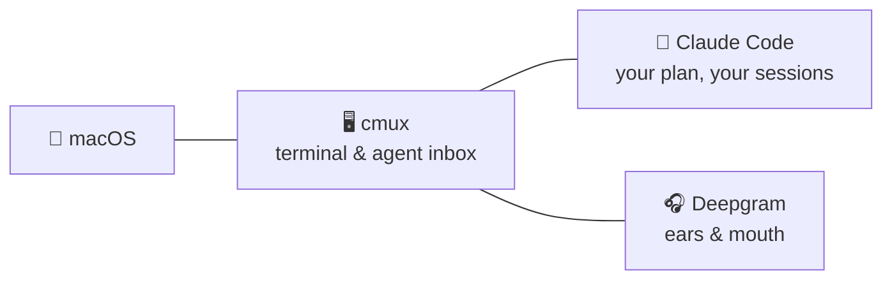
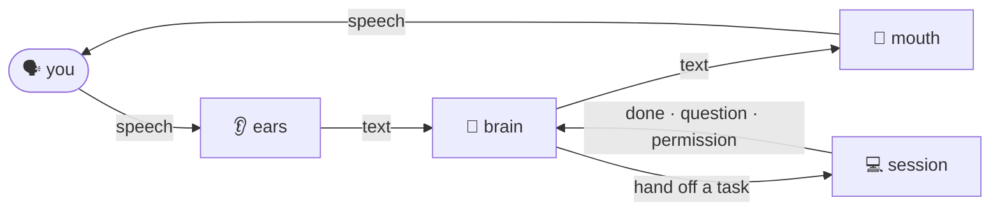
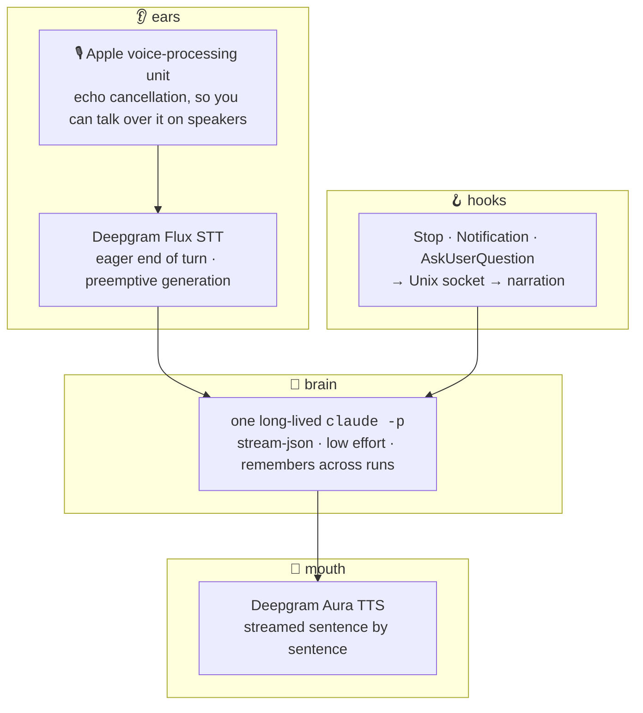

<table border="0" cellpadding="0" cellspacing="0">
<tr>
<td width="200" align="center" valign="middle">

</td>
<td valign="middle">
<pre>
 ██████╗██╗      █████╗ ██╗   ██╗██████╗ ██╗ ██████╗
██╔════╝██║     ██╔══██╗██║   ██║██╔══██╗██║██╔═══██╗
██║     ██║     ███████║██║   ██║██║  ██║██║██║   ██║
██║     ██║     ██╔══██║██║   ██║██║  ██║██║██║   ██║
╚██████╗███████╗██║  ██║╚██████╔╝██████╔╝██║╚██████╔╝
 ╚═════╝╚══════╝╚═╝  ╚═╝ ╚═════╝ ╚═════╝ ╚═╝ ╚═════╝
</pre>
<b>A voice in front of your Claude Code sessions.</b>
</td>
</tr>
</table>

You talk. It answers in a sentence or two, or hands the work to one of your Claude Code sessions and tells you when that session is done, asks something, or needs a permission.

## 🧩 What it stands on



## ⚙️ How it works



- **Discussing?** The brain answers itself, reading the project when it needs facts.
- **Work?** It sends the task to your orchestrator session through cmux's agent inbox and says so.
- **Sessions report back** through three Claude Code hooks. Claudio narrates in plain words, reads out questions and permission prompts; you answer those on the keyboard.

## 🔬 Under the hood



## 🚀 Install

```bash
uv tool install git+https://github.com/ActurialCapital/claudio
claudio          # setup on first run, then it listens
```

Setup asks for your [Deepgram](https://console.deepgram.com) key, lets you pick the orchestrator from your live cmux workspaces, a voice, the brain's model and effort, and installs the hooks. Then, from any project:

```bash
cd ~/code/myproject && claudio
```

## 🎙️ Talking to it

| say | it |
|---|---|
| "what's the sequencer doing?" | reads that pane and sums it up |
| "rebase 44 and run the tests" | hands it to the orchestrator |
| "open a session called Core" | opens a cmux workspace running `claude` |
| "use Sonnet" · "the orchestrator is Core now" | changes a setting, kept for next time |
| "mute" · "unmute" | hears nothing until you unmute |
| talk over it | pauses; a real turn cuts it, an "mm-hm" lets it go on |

Enter cuts a reply. Ctrl-C quits.

## 🎛️ Settings

`~/.config/claudio/config.json`, written by setup and by voice. `prompt.md` beside it is the persona; edit freely.

| key | default | |
|---|---|---|
| `orchestrator` | | cmux workspace that gets tasks by default |
| `model` · `effort` | `default` · `low` | the brain, through your Claude Code login |
| `voice` | `aura-2-orion-en` | any Deepgram Aura-2 voice |
| `ears` | `flux-general-en` | `flux-general-multi` for other languages |
| `eager_eot` · `eot` · `eot_timeout_ms` | `0.3` · `0.7` · `1500` | Flux end-of-turn tuning |
| `barge_in` | `true` | talking over it pauses it |
| `memory` | `true` | resume the last conversation, up to a week old |

`claudio doctor` checks everything and runs one typed turn. `claudio forget` resets the memory. `claudio set <key> <value>` changes one setting.

<details>
<summary>Hands-free picking of multiple-choice answers</summary>

By default claudio reads a session's multiple-choice question aloud and you press the key. To let your spoken answer press it, add `"Bash(cmux send-key:*)"` to the brain's allowed tools in `claudio/agent.py`; the persona already knows the keystrokes. A misheard "yes" can then press keys in your sessions.
</details>

## 📄 License

MIT
